# India's Gold & Silver Reserves: Trends, Market Analysis and Resource Insights

*A Data-Driven Analysis of Precious Metal Resources, Prices, Demand, Production and Market Behaviour in India*

## Chapter 1 - Introduction
**Background.** India is among the world's largest consumers of gold and a major consumer of silver, yet it mines very little of either. Gold and silver matter for jewellery, household savings, investment and the country's foreign-exchange reserves.

**Problem statement.** How do fluctuations in gold and silver prices relate to demand and market behaviour in India, and how do domestic resources, production and import dependence shape this ecosystem?

**Objectives.** (1) describe resources, production, imports, prices and demand; (2) measure the price-demand association for gold (total, jewellery, investment) and silver; (3) estimate price elasticity with appropriate caveats; (4) test four hypotheses; (5) build and evaluate a gold-demand prediction model; (6) present everything in an interactive dashboard.

**Key distinction.** *Mineral resources/reserves* are geological deposits (IBM). *RBI gold holdings* are gold held as part of foreign-exchange reserves. They are different things and are analysed separately. *Gold demand* is market consumption (jewellery, investment, etc.).

## Chapter 2 - Domain review
Gold demand in India is driven by jewellery (weddings, festivals) and, increasingly, investment (bars, coins, ETFs). The World Gold Council (WGC) publishes quarterly demand from Metals Focus data; jewellery is reported gross (including recycled gold) while investment is net. Silver demand comes from jewellery, silverware, coins/bars and industry (Silver Institute / Metals Focus, annual). India's resource data come from the Indian Bureau of Mines (IBM) National Mineral Inventory under the UNFC classification, updated at intervals; silver is mainly a by-product of lead-zinc mining. The RBI holds gold as part of its reserves; its tonnage changes slowly while its value moves with the gold price.

## Chapter 3 - Data collection
See `DATA_SOURCES.md` for every dataset, period and the exact table used. **Quarterly gold** (Q1 2010 - Q2 2026, 66 quarters): World Gold Council *Gold Demand Trends* Q2 2026 data tables (Metals Focus, ICE Benchmark Administration): India jewellery and bar & coin demand (tonnes), LBMA gold price (US$/oz) and domestic price (Rs/10 g, MCX-based). **Annual supply** (2012-2025): WGC India supply table (gross and net bullion imports, scrap) combined with Indian Bureau of Mines (IBM) metal production (FY2013-14 to FY2023-24; fiscal year labelled by its start year) and silver trade (FY2021-22 to FY2023-24). **Resources**: IBM National Mineral Inventory, *NMI At a Glance 2025* (Tables 5.15 gold and 5.37 silver, as on 1 April 2025; metal content, tonnes). Quarterly and annual data are kept in separate datasets because their frequencies differ.

**Demand definition used (important).** `Gold_Demand = Jewellery + Bar & coin`. WGC's headline India total also contains ETFs and industrial demand. The workbooks give no India-specific ETF series and the India Focus report gives only six quarters, so adding it would create a break in the series. Against WGC's headline total the difference is 3-15% in the six quarters where it can be checked (see the cross-check table below). Silver price and demand (Silver Institute) and an RBI gold-holdings time series were **not** in the supplied files, so Hypothesis H4 and the RBI analysis were not performed rather than estimated.

**Validation.** The extraction was cross-checked against the independent *India Focus Q2 2026* report (Table 1) and against the Q1 2026 workbook (see `outputs/tables/crosscheck_*.csv`). State resource totals reconcile exactly to IBM's published all-India totals (gold 658.80 t, silver 26,819.75 t).

## Chapter 4 - Data preprocessing
Cleaning steps actually performed are listed in `outputs/reports/cleaning_log.md`. In general: numeric coercion, duplicate removal, state-name standardisation, unit conversion (kg to tonnes; oz to grams), derivation of Investment = Bar&Coin + ETF, and flagging (not deleting) suspicious values. Engineered features: YoY/QoQ growth, log changes, lags (1, 2, 4 quarters), quarter number, price index (base = 100), import dependency = imports / (production + imports + recycling) x 100.

## Chapter 5 - Exploratory Data Analysis
### Descriptive statistics (gold, quarterly)
| Unnamed: 0 | count | mean | median | min | max | std | variance | Q1 | Q3 | IQR | skew | missing |
|---|---|---|---|---|---|---|---|---|---|---|---|---|
| Gold_Price | 66.0 | 44275.196 | 30984.869 | 16605.216 | 151105.452 | 28400.417 | 806583689.787 | 27953.928 | 51115.144 | 23161.216 | 2.238 | 0.0 |
| Gold_Demand | 66.0 | 196.681 | 192.215 | 63.732 | 343.882 | 59.409 | 3529.443 | 158.363 | 236.397 | 78.034 | 0.204 | 0.0 |
| Jewellery_Demand | 66.0 | 140.576 | 145.0 | 43.975 | 264.989 | 42.247 | 1784.849 | 117.755 | 169.04 | 51.285 | 0.106 | 0.0 |
| Investment_Demand | 66.0 | 56.104 | 50.866 | 19.757 | 133.14 | 24.614 | 605.853 | 39.299 | 66.483 | 27.184 | 1.026 | 0.0 |
| Bar_Coin_Demand | 66.0 | 56.104 | 50.866 | 19.757 | 133.14 | 24.614 | 605.853 | 39.299 | 66.483 | 27.184 | 1.026 | 0.0 |

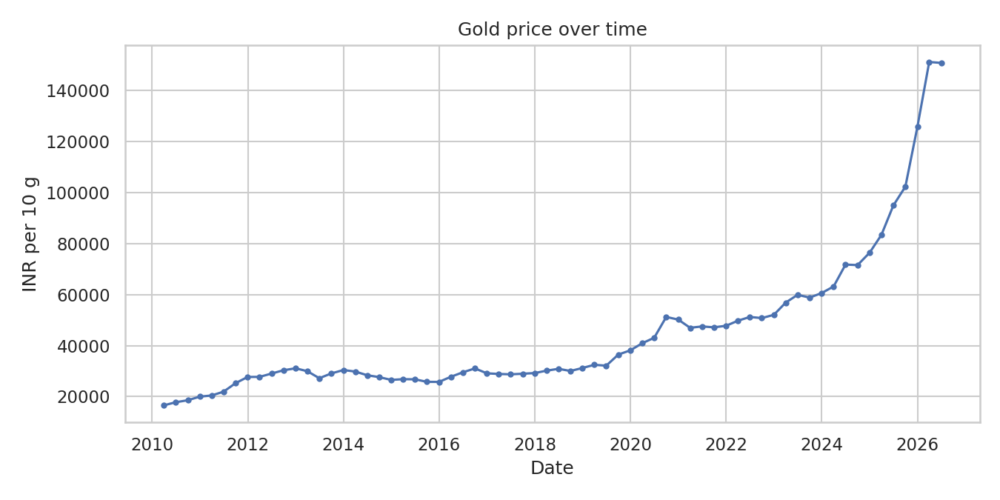

*Gold price over time*

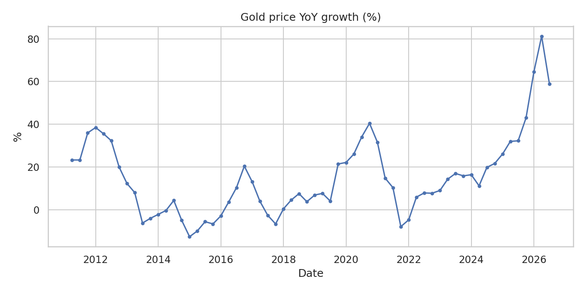

*Gold price YoY growth*

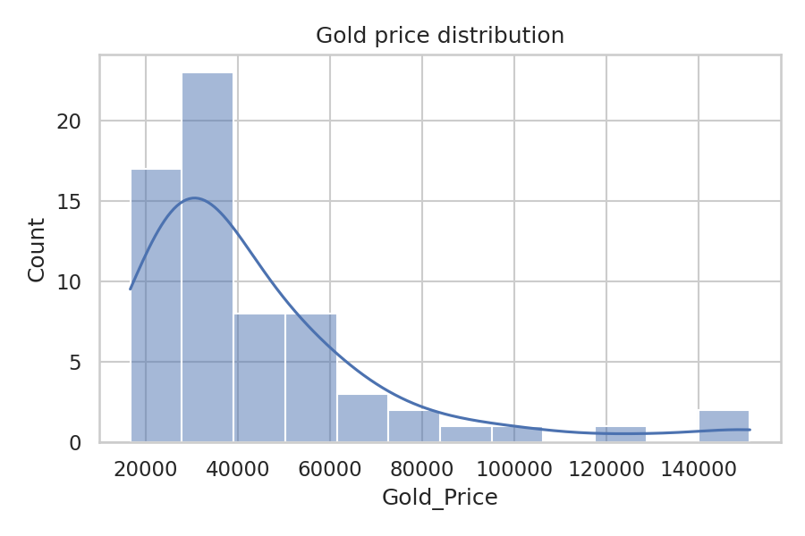

*Gold price distribution*

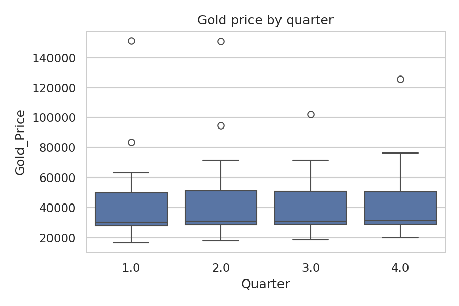

*Gold price by quarter*

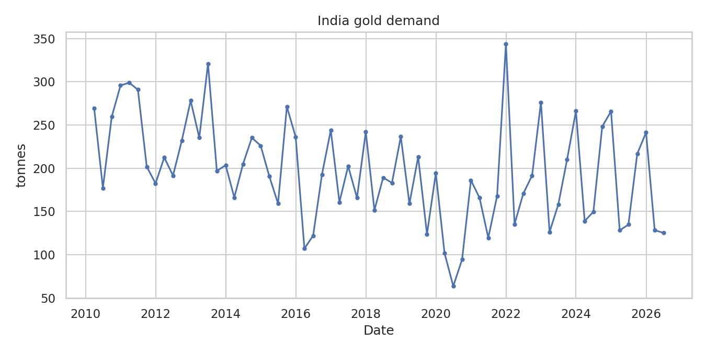

*Gold demand*

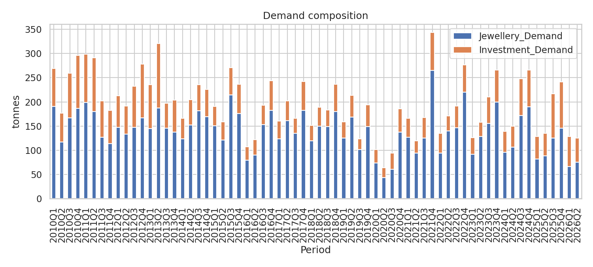

*Demand composition*

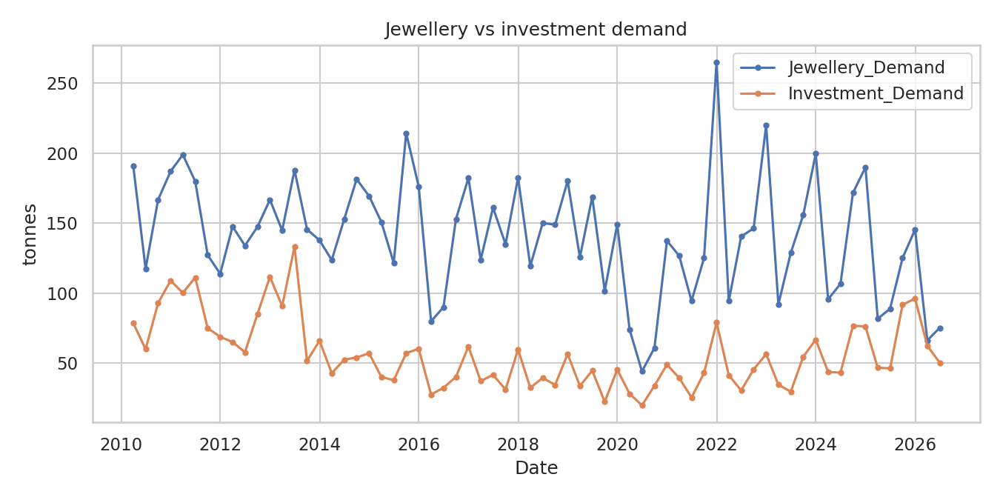

*Jewellery vs investment*

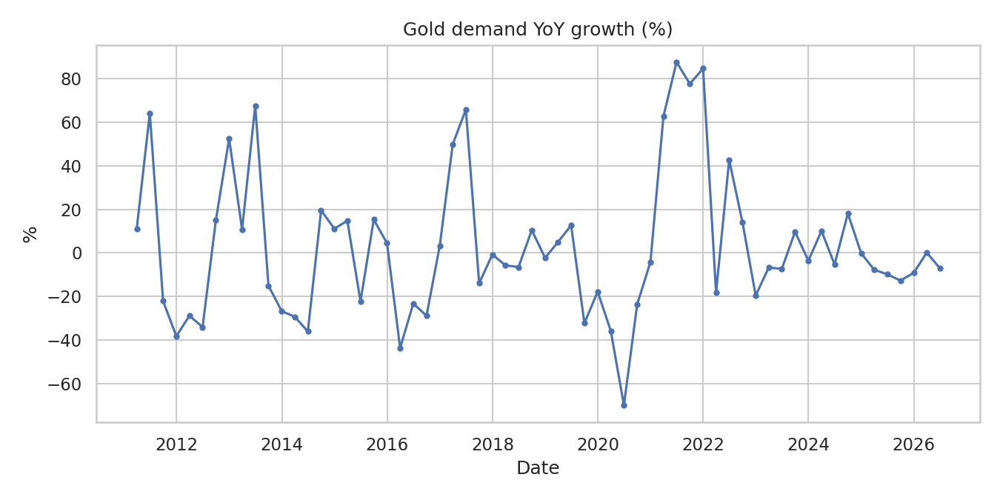

*Demand growth*

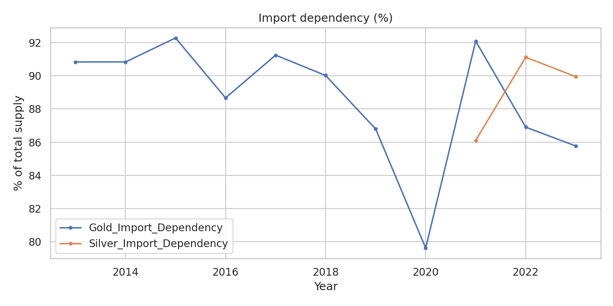

*Import dependency*

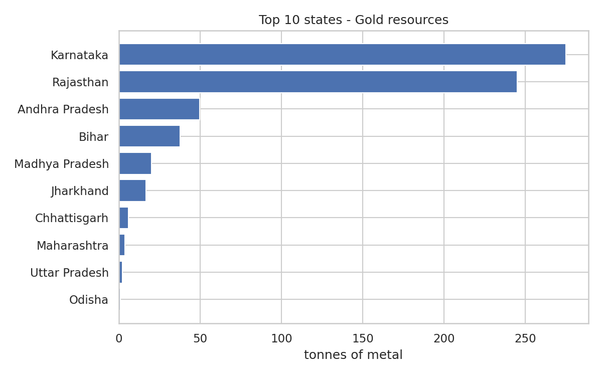

*Top states, gold resources*

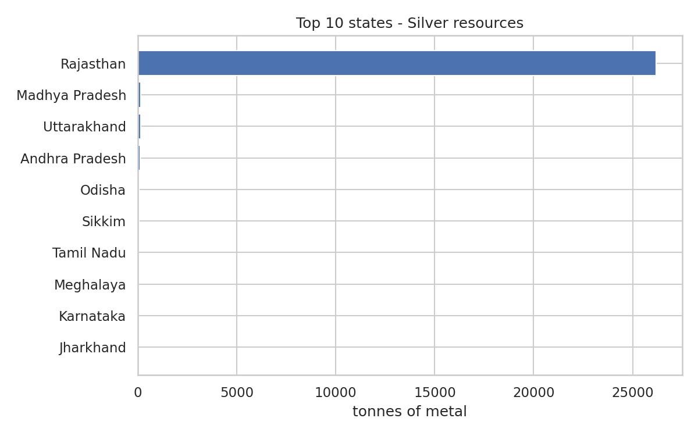

*Top states, silver resources*

### Descriptive statistics (annual)
| Unnamed: 0 | count | mean | median | min | max | std | variance | Q1 | Q3 | IQR | skew | missing |
|---|---|---|---|---|---|---|---|---|---|---|---|---|
| Gold_Production_t | 11.0 | 11.015 | 10.087 | 7.387 | 16.639 | 2.664 | 7.099 | 9.598 | 12.562 | 2.963 | 0.862 | 3.0 |
| Gold_Imports_t | 14.0 | 866.524 | 869.72 | 401.69 | 1084.367 | 184.389 | 33999.275 | 765.105 | 1010.603 | 245.498 | -1.147 | 0.0 |
| Gold_Exports_t | 3.0 | 1.423 | 1.521 | 0.126 | 2.623 | 1.251 | 1.566 | 0.823 | 2.072 | 1.249 | -0.349 | 11.0 |
| Gold_Recycling_t | 14.0 | 96.667 | 94.128 | 75.229 | 119.528 | 15.015 | 225.457 | 87.333 | 110.127 | 22.794 | 0.39 | 0.0 |
| Silver_Production_t | 11.0 | 592.683 | 609.34 | 349.774 | 819.725 | 163.985 | 26891.079 | 443.627 | 709.724 | 266.098 | -0.121 | 3.0 |
| Silver_Imports_t | 3.0 | 6638.333 | 7337.0 | 4422.0 | 8156.0 | 1962.598 | 3851790.333 | 5879.5 | 7746.5 | 1867.0 | -1.399 | 11.0 |
| Silver_Exports_t | 3.0 | 117.0 | 130.0 | 89.0 | 132.0 | 24.269 | 589.0 | 109.5 | 131.0 | 21.5 | -1.719 | 11.0 |
| Gold_Net_Imports_t | 14.0 | 776.171 | 792.147 | 351.585 | 957.423 | 169.635 | 28776.015 | 679.58 | 918.774 | 239.194 | -1.16 | 0.0 |
| Gold_Domestic_Other_t | 14.0 | 11.018 | 9.965 | 6.9 | 17.742 | 2.957 | 8.747 | 9.298 | 11.625 | 2.328 | 1.22 | 0.0 |
| Gold_WGC_Total_Supply_t | 14.0 | 883.856 | 906.913 | 456.104 | 1062.763 | 167.402 | 28023.296 | 804.164 | 1016.087 | 211.924 | -1.322 | 0.0 |
| Gold_Total_Supply_t | 11.0 | 974.942 | 998.216 | 504.596 | 1174.979 | 201.196 | 40479.674 | 895.356 | 1131.983 | 236.627 | -1.344 | 3.0 |
| Gold_Import_Dependency | 11.0 | 88.643 | 90.022 | 79.606 | 92.288 | 3.74 | 13.99 | 86.85 | 91.045 | 4.195 | -1.5 | 3.0 |
| Gold_Domestic_Share | 11.0 | 1.17 | 1.084 | 0.804 | 1.77 | 0.335 | 0.112 | 0.89 | 1.37 | 0.48 | 0.665 | 3.0 |
| Gold_Recycling_Share | 11.0 | 10.187 | 8.713 | 6.826 | 18.93 | 3.537 | 12.509 | 7.967 | 11.903 | 3.936 | 1.626 | 3.0 |
| Silver_Total_Supply_t | 3.0 | 7414.27 | 8156.725 | 5135.653 | 8950.431 | 2012.849 | 4051562.739 | 6646.189 | 8553.578 | 1907.389 | -1.434 | 11.0 |
| Silver_Import_Dependency | 3.0 | 89.059 | 89.95 | 86.104 | 91.124 | 2.626 | 6.896 | 88.027 | 90.537 | 2.51 | -1.351 | 11.0 |
| Silver_Domestic_Share | 3.0 | 10.941 | 10.05 | 8.876 | 13.896 | 2.626 | 6.896 | 9.463 | 11.973 | 2.51 | 1.351 | 11.0 |
| Gold_Net_Import_Share_WGC | 14.0 | 87.223 | 87.309 | 77.084 | 91.764 | 3.875 | 15.014 | 85.677 | 90.061 | 4.384 | -1.328 | 0.0 |
| Gold_Scrap_Share_WGC | 14.0 | 11.476 | 11.172 | 7.544 | 20.942 | 3.53 | 12.464 | 9.019 | 12.684 | 3.665 | 1.498 | 0.0 |

### Resource concentration
| group | resources | share_pct | year |
|---|---|---|---|
| Top 5 states | 627.24 | 95.209 | 2025 |
| Rest of listed states | 31.56 | 4.791 | 2025 |

| group | resources | share_pct | year |
|---|---|---|---|
| Top 5 states | 26682.38 | 99.488 | 2025 |
| Rest of listed states | 137.371 | 0.512 | 2025 |

### Seasonality check (average by quarter)
| Quarter | mean | std | count |
|---|---|---|---|
| 1.0 | 169.227 | 55.703 | 17.0 |
| 2.0 | 176.094 | 62.146 | 17.0 |
| 3.0 | 199.488 | 46.97 | 16.0 |
| 4.0 | 244.916 | 42.826 | 16.0 |

Seasonality should only be claimed if the pattern is consistent across many years.

## Chapter 6 - Statistical Analysis
### Correlation and regression
| analysis | basis | x | y | n | pearson_r | pearson_p | spearman_rho | spearman_p | slope | intercept | r_squared | slope_p | strength |
|---|---|---|---|---|---|---|---|---|---|---|---|---|---|
| Gold price vs total demand | levels | Gold_Price | Gold_Demand | 66 | -0.257 | 0.037 | -0.349 | 0.004 | -0.001 | 220.455 | 0.066 | 0.037 | weak negative |
| Gold price vs jewellery demand | levels | Gold_Price | Jewellery_Demand | 66 | -0.352 | 0.004 | -0.358 | 0.003 | -0.001 | 163.744 | 0.124 | 0.004 | moderate negative |
| Gold price vs investment demand | levels | Gold_Price | Investment_Demand | 66 | -0.016 | 0.9 | -0.212 | 0.087 | -0.0 | 56.71 | 0.0 | 0.9 | weak negative |
| Gold price vs total demand (YoY log change) | yoy_log_change | Gold_Price_LogChg | Gold_Demand_LogChg | 62 | -0.329 | 0.009 | -0.358 | 0.004 | -0.7 | 0.065 | 0.108 | 0.009 | moderate negative |
| Gold price vs jewellery demand (YoY log change) | yoy_log_change | Gold_Price_LogChg | Jewellery_Demand_LogChg | 62 | -0.465 | 0.0 | -0.518 | 0.0 | -1.06 | 0.102 | 0.216 | 0.0 | moderate negative |
| Gold price vs investment demand (YoY log change) | yoy_log_change | Gold_Price_LogChg | Investment_Demand_LogChg | 62 | 0.046 | 0.725 | 0.088 | 0.494 | 0.103 | -0.022 | 0.002 | 0.725 | weak positive |

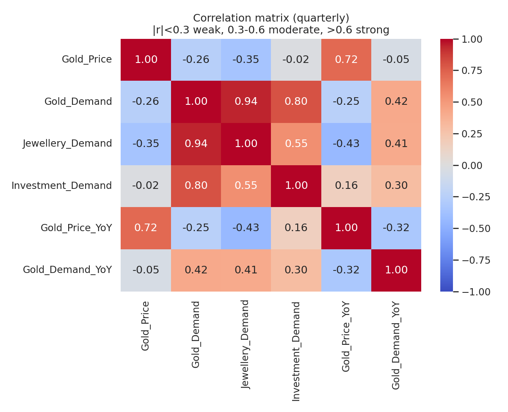

*Correlation heatmap*

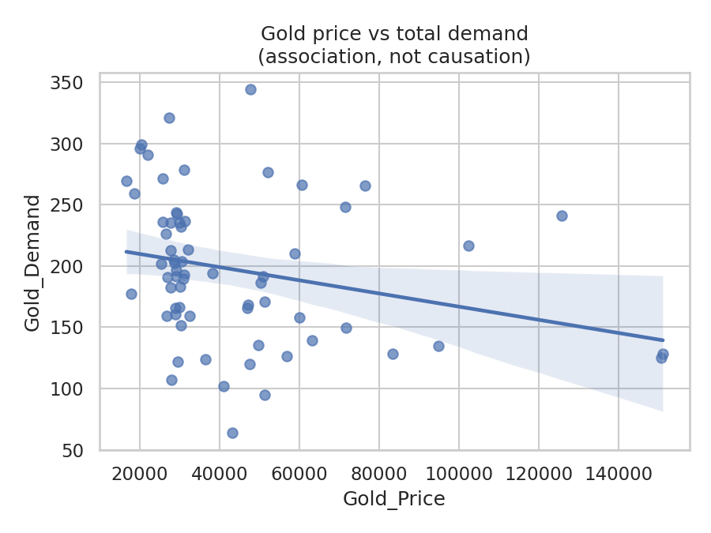

*Gold price vs total demand*

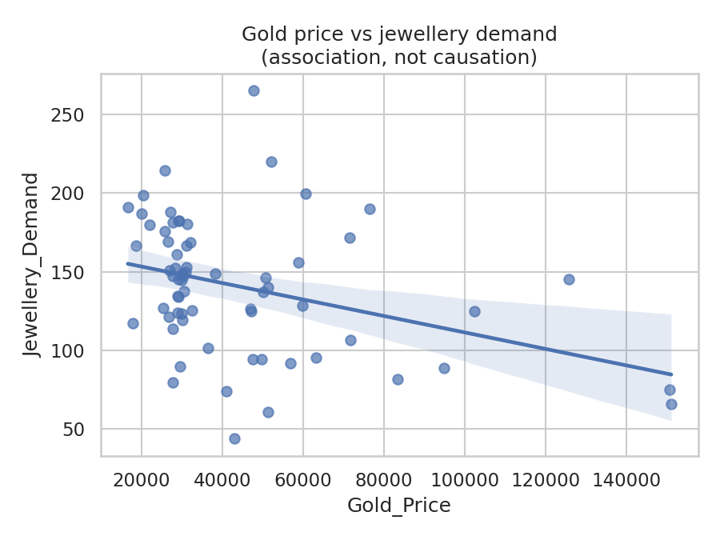

*Gold price vs jewellery demand*

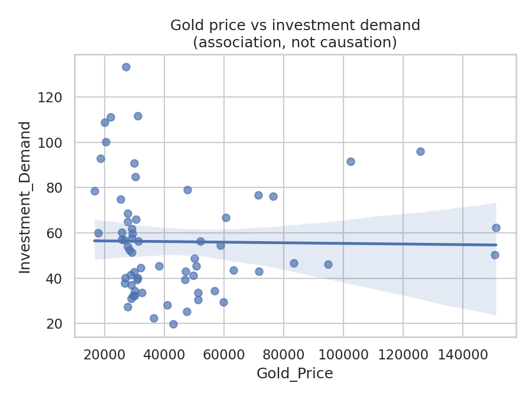

*Gold price vs investment demand*

### Price elasticity (log-log slope; interpret with caution)
| series | basis | n | elasticity | std_err | p_value | ci_low | ci_high | r_squared | interpretation |
|---|---|---|---|---|---|---|---|---|---|
| Gold total demand | levels | 66 | -0.209 | 0.078 | 0.009 | -0.364 | -0.054 | 0.102 | inelastic negative relationship |
| Gold total demand | yoy_log_change | 62 | -0.7 | 0.259 | 0.009 | -1.218 | -0.181 | 0.108 | inelastic negative relationship |
| Gold jewellery demand | levels | 66 | -0.267 | 0.077 | 0.001 | -0.421 | -0.112 | 0.156 | inelastic negative relationship |
| Gold jewellery demand | yoy_log_change | 62 | -1.06 | 0.26 | 0.0 | -1.581 | -0.539 | 0.216 | elastic (|e|>1, negative) |
| Gold investment demand | levels | 66 | -0.097 | 0.105 | 0.362 | -0.307 | 0.114 | 0.013 | inelastic negative relationship; NOT statistically significant, so treat as inconclusive |
| Gold investment demand | yoy_log_change | 62 | 0.103 | 0.293 | 0.725 | -0.482 | 0.689 | 0.002 | positive relationship (demand rises with price in this data); NOT statistically significant, so treat as inconclusive |

_Not available - the required data/step was not run._

### Hypothesis tests (alpha = 0.05) - levels
| hypothesis | test | n | statistic_t | p_value | alpha | decision | interpretation |
|---|---|---|---|---|---|---|---|
| H1 gold price vs gold demand | Pearson correlation t-test | 66 | -2.125 | 0.037 | 0.05 | Reject H0 | Significant negative association (not proof of causation). |
| H2 gold price vs jewellery demand | Pearson correlation t-test | 66 | -3.006 | 0.004 | 0.05 | Reject H0 | Significant negative association (not proof of causation). |
| H3 gold price vs investment demand | Pearson correlation t-test | 66 | -0.126 | 0.9 | 0.05 | Fail to reject H0 | No significant negative association (not proof of causation). |

### Hypothesis tests - YoY changes (removes shared trend)
| hypothesis | test | n | statistic_t | p_value | alpha | decision | interpretation |
|---|---|---|---|---|---|---|---|
| H1 gold price vs gold demand [YoY] | Pearson correlation t-test | 62 | -2.699 | 0.009 | 0.05 | Reject H0 | Significant negative association (not proof of causation). |
| H2 gold price vs jewellery demand [YoY] | Pearson correlation t-test | 62 | -4.071 | 0.0 | 0.05 | Reject H0 | Significant negative association (not proof of causation). |
| H3 gold price vs investment demand [YoY] | Pearson correlation t-test | 62 | 0.354 | 0.725 | 0.05 | Fail to reject H0 | No significant positive association (not proof of causation). |

### Robustness of the elasticity (Newey-West errors, COVID exclusion, sub-periods)
YoY changes overlap, so ordinary p-values are too optimistic; the table below uses HAC (Newey-West, 4 lags) errors. `COVID window` excludes quarters whose YoY change involves 2020Q1-2021Q2.

| series | sample | n | elasticity | hac_se | p_value_hac | ci_low | ci_high | r_squared | significant_5pct |
|---|---|---|---|---|---|---|---|---|---|
| Total demand | Full sample (HAC) | 62 | -0.7 | 0.331 | 0.034 | -1.348 | -0.052 | 0.108 | True |
| Total demand | Excluding COVID window (HAC) | 52 | -0.362 | 0.205 | 0.078 | -0.764 | 0.04 | 0.051 | False |
| Total demand | 2011-2019 only (HAC) | 36 | -0.772 | 0.26 | 0.003 | -1.282 | -0.262 | 0.106 | True |
| Total demand | 2022Q3-2026Q2 only (HAC) | 16 | -0.157 | 0.108 | 0.144 | -0.368 | 0.054 | 0.056 | False |
| Jewellery demand | Full sample (HAC) | 62 | -1.06 | 0.325 | 0.001 | -1.698 | -0.423 | 0.216 | True |
| Jewellery demand | Excluding COVID window (HAC) | 52 | -0.676 | 0.147 | 0.0 | -0.965 | -0.387 | 0.191 | True |
| Jewellery demand | 2011-2019 only (HAC) | 36 | -0.904 | 0.208 | 0.0 | -1.311 | -0.497 | 0.167 | True |
| Jewellery demand | 2022Q3-2026Q2 only (HAC) | 16 | -0.555 | 0.1 | 0.0 | -0.752 | -0.358 | 0.412 | True |
| Investment (bar & coin) demand | Full sample (HAC) | 62 | 0.103 | 0.339 | 0.761 | -0.562 | 0.769 | 0.002 | False |
| Investment (bar & coin) demand | Excluding COVID window (HAC) | 52 | 0.282 | 0.327 | 0.388 | -0.358 | 0.923 | 0.017 | False |
| Investment (bar & coin) demand | 2011-2019 only (HAC) | 36 | -0.403 | 0.43 | 0.349 | -1.247 | 0.441 | 0.018 | False |
| Investment (bar & coin) demand | 2022Q3-2026Q2 only (HAC) | 16 | 0.432 | 0.282 | 0.125 | -0.12 | 0.985 | 0.135 | False |

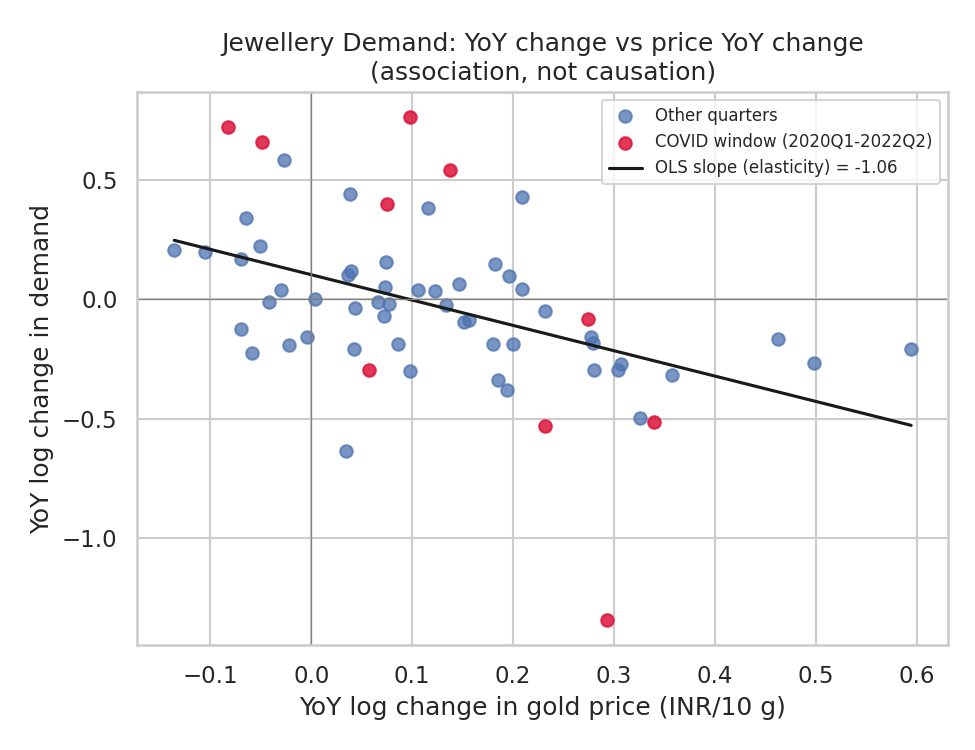

*YoY change: jewellery demand vs gold price*

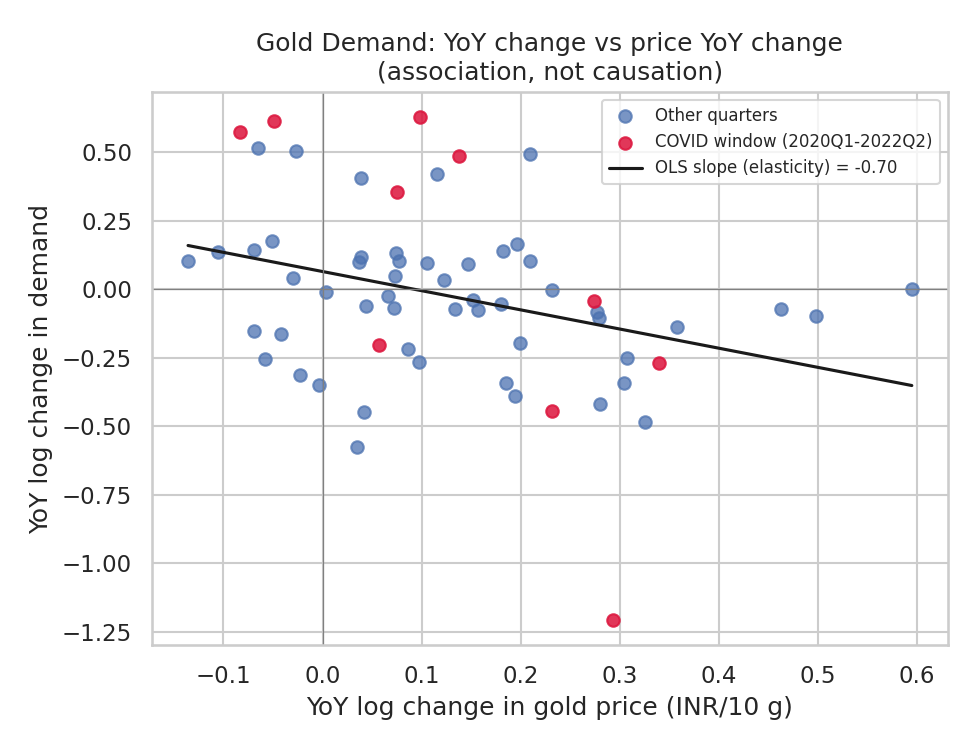

*YoY change: total demand vs gold price*

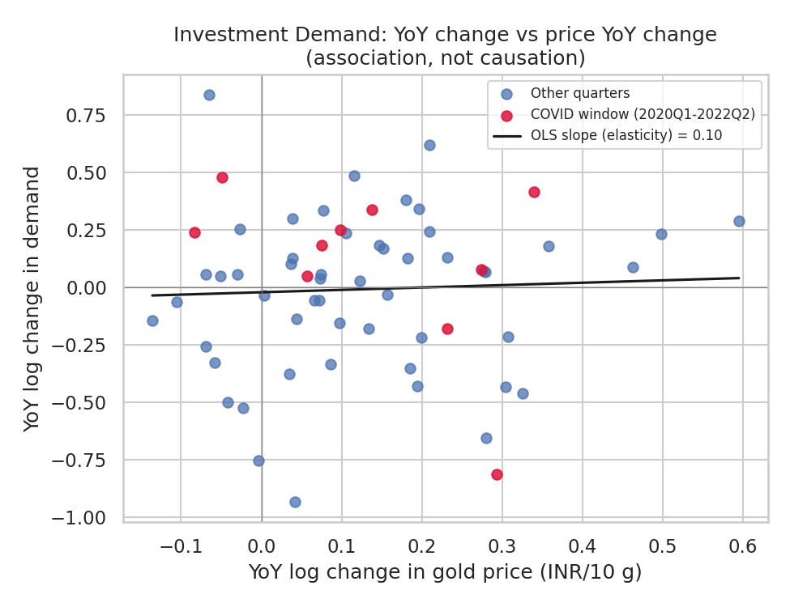

*YoY change: bar & coin demand vs gold price*

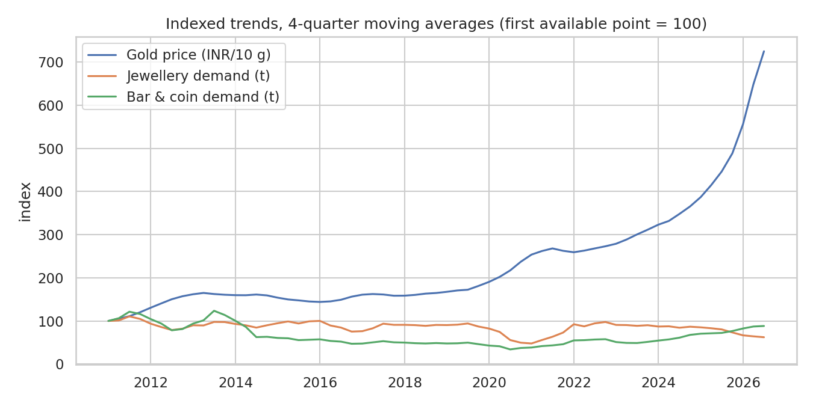

*Indexed trends (4-quarter moving averages)*

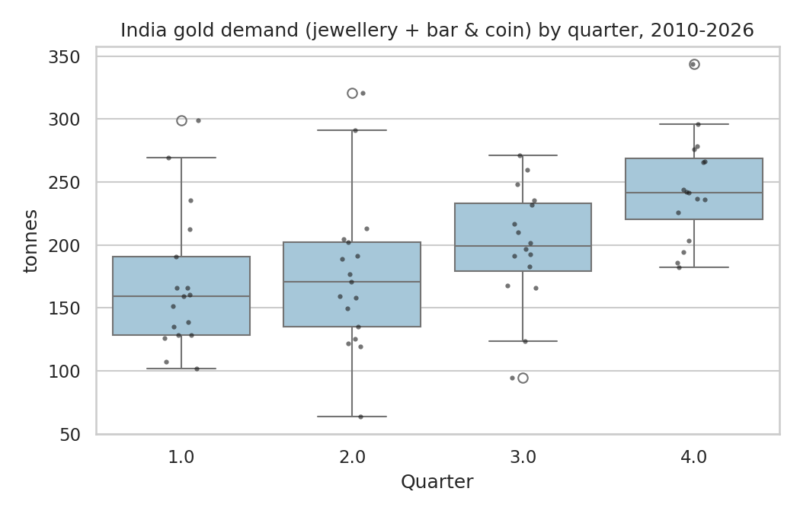

*Seasonality of demand*

### Data cross-check against the India Focus report
| Period | Jewellery_diff_t | BarCoin_diff_t | Price_USD_diff | Price_INR_diff | Our_Demand_t(Jew+Bar) | WGC_Headline_Total_t | Gap_ETF_plus_Industrial_t | Gap_pct_of_headline |
|---|---|---|---|---|---|---|---|---|
| 2025Q1 | 0.0 | -0.0 | -0.4 | -1.0 | 128.3 | 137.4 | 9.1 | 6.6 |
| 2025Q2 | -0.0 | 0.0 | 0.4 | -1.0 | 134.9 | 139.1 | 4.2 | 3.0 |
| 2025Q3 | 0.0 | 0.0 | -0.5 | -2.0 | 216.6 | 229.8 | 13.2 | 5.7 |
| 2025Q4 | 0.0 | -0.0 | 0.2 | -2.0 | 241.3 | 261.9 | 20.6 | 7.9 |
| 2026Q1 | 0.0 | -0.0 | -0.1 | -3.0 | 128.4 | 150.6 | 22.2 | 14.7 |
| 2026Q2 | -0.0 | -0.0 | 0.3 | 12.0 | 125.3 | 130.9 | 5.6 | 4.2 |

## Chapter 7 - Machine Learning
**Target:** quarterly Gold_Demand. **Features:** Gold_Price, Gold_Price_Change, demand lags 1/2/4, quarter number. Same-quarter jewellery and investment demand are excluded because they add up to the target (data leakage). **Split:** chronological (earliest 80% train, latest 20% test), TimeSeriesSplit CV on the training part.

| Model | MAE | RMSE | R2 | CV_RMSE_train |
|---|---|---|---|---|
| Linear Regression | 98.512 | 139.494 | -5.195 | 65.261 |
| Random Forest | 41.319 | 53.047 | 0.104 | 60.371 |
| Naive baseline (last quarter) | 60.719 | 77.018 | -0.888 |  |

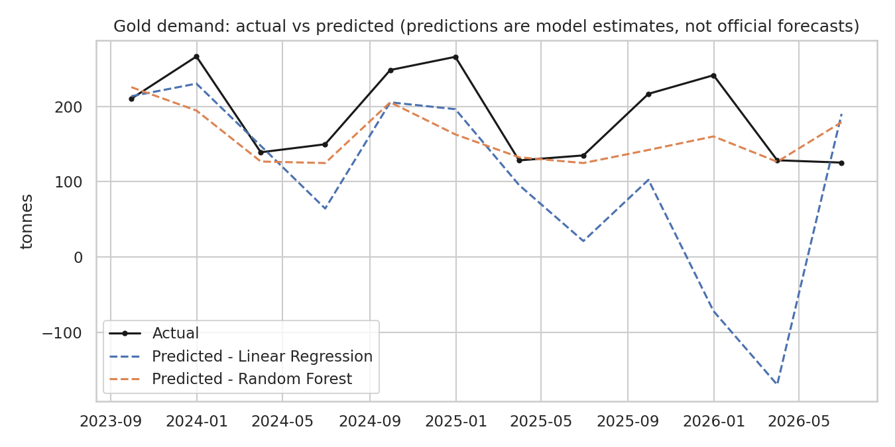

*Actual vs predicted (model estimates)*

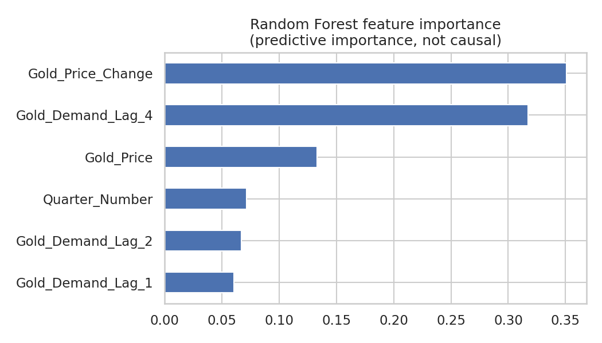

*Feature importance*

### Test-set predictions
| Date | Gold_Demand | Predicted_Linear Regression | Predicted_Random Forest |
|---|---|---|---|
| 2023-09-30 | 210.244 | 213.494 | 225.473 |
| 2023-12-31 | 266.248 | 230.18 | 194.479 |
| 2024-03-31 | 139.045 | 147.56 | 126.757 |
| 2024-06-30 | 149.687 | 64.332 | 124.743 |
| 2024-09-30 | 248.268 | 205.366 | 205.434 |
| 2024-12-31 | 265.786 | 196.26 | 162.755 |
| 2025-03-31 | 128.272 | 95.582 | 132.447 |
| 2025-06-30 | 134.876 | 21.153 | 124.743 |
| 2025-09-30 | 216.65 | 102.456 | 142.108 |
| 2025-12-31 | 241.339 | -71.893 | 160.094 |
| 2026-03-31 | 128.422 | -169.607 | 126.454 |
| 2026-06-30 | 125.349 | 190.005 | 179.019 |

### Version 2 - walk-forward back-test with seasonal benchmark (recommended results)
The version-1 set-up above follows the project template: a single hold-out, price *levels* as features and a 'last quarter' baseline. It is kept for transparency but is **not** reliable here: test prices lie outside the training range, and 'last quarter' is a weak yardstick for a seasonal series. Version 2 models the year-on-year change, refits one quarter at a time over the last 16 quarters, and compares against the seasonal-naive forecast (same quarter last year).

| Model | n_test_quarters | MAE | RMSE | MAPE_pct | R2 |
|---|---|---|---|---|---|
| Seasonal naive (same quarter last year) | 16 | 18.287 | 24.393 | 9.17 | 0.81 |
| Ridge (YoY features) | 16 | 28.03 | 31.954 | 15.754 | 0.675 |
| Random Forest (YoY features) | 16 | 25.741 | 32.374 | 12.745 | 0.666 |
| Price-adjusted seasonal (YoY elasticity) | 16 | 30.157 | 36.593 | 15.431 | 0.573 |
| Naive (last quarter) | 16 | 63.496 | 79.952 | 38.846 | -1.038 |

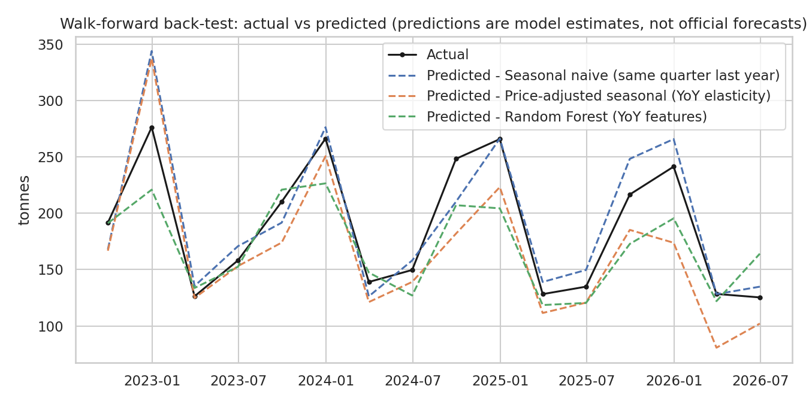

*Walk-forward back-test*

### Scenario for the next quarter (conditional on assumed prices, **not a forecast**)
The full-sample slope is dominated by 2011-2019 and COVID; the post-2022 slope is much flatter. Both are shown because the true sensitivity is uncertain. Ranges are approximately +/-1.96 x back-test RMSE.

| period | scenario | assumed_price_INR_10g | yoy_log_price_change | seasonal_naive_t | demand_full_sample_t | range_full_sample_t | demand_post_2022Q2_t | range_post_2022Q2_t | max_historical_yoy_log_price_change |
|---|---|---|---|---|---|---|---|---|---|
| 2026Q3 | Price 10% below latest quarter | 135670 | 0.282 | 216.6 | 189.8 | 118 to 262 | 209.3 | 138 to 281 | 0.595 |
| 2026Q3 | Price flat at latest quarter | 150745 | 0.388 | 216.6 | 176.3 | 105 to 248 | 205.8 | 134 to 278 | 0.595 |
| 2026Q3 | Price 10% above latest quarter | 165819 | 0.483 | 216.6 | 164.9 | 93 to 237 | 202.8 | 131 to 274 | 0.595 |

## Chapter 8 - Dashboard
See `dashboard/POWER_BI_GUIDE.md` for the six pages, data files and DAX measures.

## Chapter 9 - Results and Insights
**Gold price vs total demand (levels)**
- *Observation:* Gold_Demand shows a weak negative association with Gold_Price.
- *Evidence:* Pearson r = -0.26 (p = 0.037), Spearman rho = -0.35, R2 = 0.07, n = 66; the association is statistically significant at alpha = 0.05.
- *Interpretation:* higher prices tend to coincide with lower Gold_Demand in this sample; other factors (income, festivals, duties, global prices) may explain part of this.
- *Limitation:* correlation is not causation; a small sample and trending series can distort results.

**Gold price vs jewellery demand (levels)**
- *Observation:* Jewellery_Demand shows a moderate negative association with Gold_Price.
- *Evidence:* Pearson r = -0.35 (p = 0.004), Spearman rho = -0.36, R2 = 0.12, n = 66; the association is statistically significant at alpha = 0.05.
- *Interpretation:* higher prices tend to coincide with lower Jewellery_Demand in this sample; other factors (income, festivals, duties, global prices) may explain part of this.
- *Limitation:* correlation is not causation; a small sample and trending series can distort results.

**Gold price vs investment demand (levels)**
- *Observation:* Investment_Demand shows a weak negative association with Gold_Price.
- *Evidence:* Pearson r = -0.02 (p = 0.900), Spearman rho = -0.21, R2 = 0.00, n = 66; the association is not statistically significant at alpha = 0.05.
- *Interpretation:* higher prices tend to coincide with lower Investment_Demand in this sample; other factors (income, festivals, duties, global prices) may explain part of this.
- *Limitation:* correlation is not causation; a small sample and trending series can distort results.

**Gold price vs total demand (YoY log change) (yoy_log_change)**
- *Observation:* Gold_Demand_LogChg shows a moderate negative association with Gold_Price_LogChg.
- *Evidence:* Pearson r = -0.33 (p = 0.009), Spearman rho = -0.36, R2 = 0.11, n = 62; the association is statistically significant at alpha = 0.05.
- *Interpretation:* higher prices tend to coincide with lower Gold_Demand_LogChg in this sample; other factors (income, festivals, duties, global prices) may explain part of this.
- *Limitation:* correlation is not causation; a small sample and trending series can distort results.

**Gold price vs jewellery demand (YoY log change) (yoy_log_change)**
- *Observation:* Jewellery_Demand_LogChg shows a moderate negative association with Gold_Price_LogChg.
- *Evidence:* Pearson r = -0.47 (p = 0.000), Spearman rho = -0.52, R2 = 0.22, n = 62; the association is statistically significant at alpha = 0.05.
- *Interpretation:* higher prices tend to coincide with lower Jewellery_Demand_LogChg in this sample; other factors (income, festivals, duties, global prices) may explain part of this.
- *Limitation:* correlation is not causation; a small sample and trending series can distort results.

**Gold price vs investment demand (YoY log change) (yoy_log_change)**
- *Observation:* Investment_Demand_LogChg shows a weak positive association with Gold_Price_LogChg.
- *Evidence:* Pearson r = 0.05 (p = 0.725), Spearman rho = 0.09, R2 = 0.00, n = 62; the association is not statistically significant at alpha = 0.05.
- *Interpretation:* higher prices tend to coincide with higher Investment_Demand_LogChg in this sample; other factors (income, festivals, duties, global prices) may explain part of this.
- *Limitation:* correlation is not causation; a small sample and trending series can distort results.

## Chapter 10 - Limitations
Demand is jewellery + bar & coin, which omits ETF and industrial demand (3-15% of WGC's headline total where checkable); 66 quarters with a strong trend in price, so level-based statistics are unreliable and YoY changes overlap (handled with HAC errors); the COVID shock is influential; production is fiscal-year data matched to calendar-year imports (FY labelled by start year); resource data are a single 1 April 2025 snapshot; silver price/demand and RBI holdings series were not supplied; the 2022Q3-2026Q2 sub-sample has only 16 observations; different frequencies; resource data are periodic snapshots; WGC jewellery is gross and investment is net; methodology changes and data revisions; correlation is not causation; model predictions carry uncertainty and are not official forecasts.

## Chapter 11 - Future Scope
Monthly data; exchange rate, inflation, interest rate, income and festival variables; global gold price; import-duty changes; SARIMA/Prophet and other forecasting models; state-level demand.

## Chapter 12 - Conclusion
**Answer to the research question.** In India's quarterly data (2010-2026, n = 66) higher domestic gold prices are associated with *lower jewellery volumes*, but not with lower bar-and-coin volumes.

1. **Jewellery demand is price-sensitive.** The YoY log-log elasticity is -1.06 (full sample; 95% CI -1.70 to -0.42, Newey-West errors). It stays negative and significant when COVID quarters are excluded (-0.68), in 2011-2019 (-0.90) and in 2022Q3-2026Q2 (-0.56). Volumes adjust to high prices (lighter, lower-carat pieces) while rupee spending still rises, so the result is about tonnes, not about rupees spent.
2. **Total demand is only weakly and unstably related to price.** Elasticity -0.70 on the full sample, but -0.36 (p = 0.078) excluding COVID and -0.16 (p = 0.144) after 2022. The headline significance of H1 rests substantially on the COVID shock.
3. **Bar and coin demand shows no significant association with price** in any sample (elasticity 0.10, p = 0.76); H3 is not rejected. Price momentum, not price level, may matter for investors; this was not tested.
4. **Prediction.** Over a 16-quarter walk-forward back-test the best model was the *seasonal naive* benchmark (same quarter last year: RMSE 24.4 t, MAE 18.3 t, R2 0.81). The best machine-learning model, Ridge (YoY features), reached RMSE 32.0 t. **Price-based ML models did not beat the seasonal benchmark**, so on this data price adds no demonstrable predictive value beyond seasonality. The template's level-based linear model failed badly (predicting negative demand) because test-period prices lay far outside the training range.
5. **Supply and resources.** India is import-dependent: net bullion imports were 77-92% of total supply in 2012-2025 (WGC). Gold resources are concentrated: the top five states hold 95% of the 658.8 t of metal; Karnataka and Rajasthan alone hold 79%, and Rajasthan holds 98% of silver resources (silver is mostly a lead-zinc by-product). The entire identified gold resource base is smaller than one recent full year of consumer demand (721 t in 2025).

**Not answered with the supplied data:** the silver price-demand hypothesis (H4) and RBI holdings analysis (no series supplied). These are future work, not conclusions.
